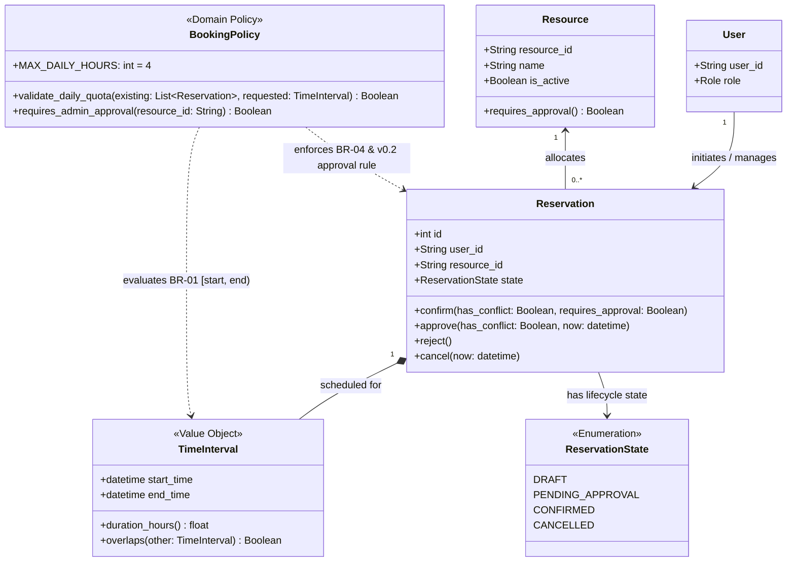
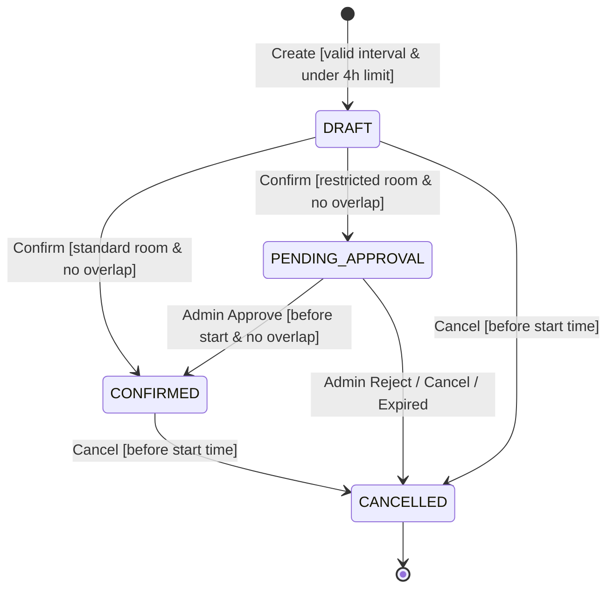
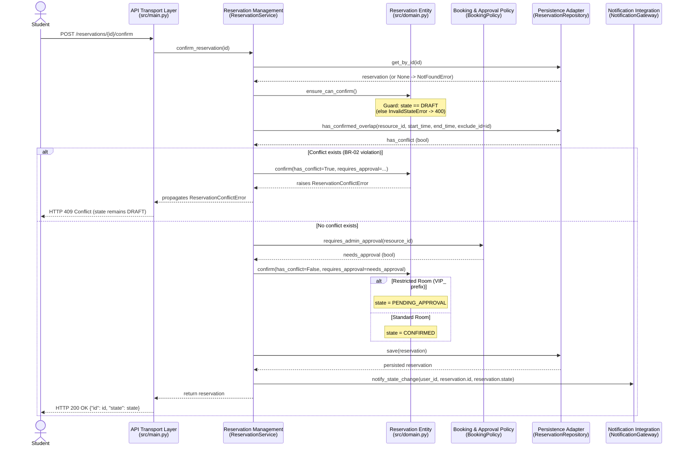
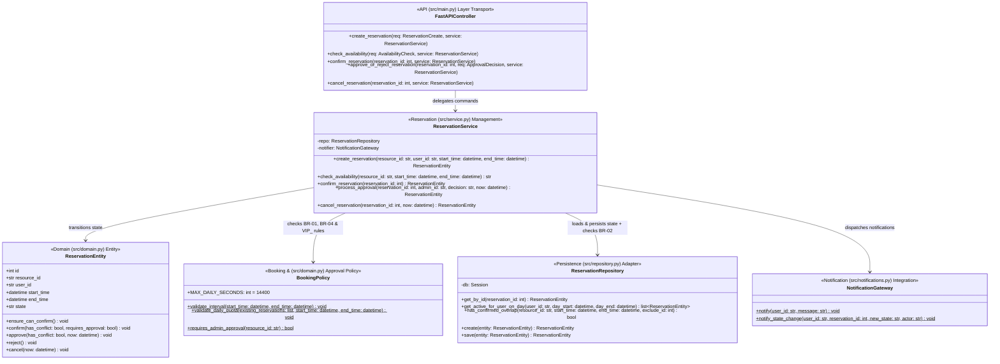

# C03 — Architecture and Decisions

## Part A: AS-IS Realization of One Scenario

### A1. Identify the Scenario

| Item                     | Value                                                                                                                            |
| :----------------------- | :------------------------------------------------------------------------------------------------------------------------------- |
| **Scenario / Operation** | `OP-03 — Confirm Reservation`                                                                                                    |
| **Requirements**         | `REQ-03` (Confirm DRAFT when resource active and no overlap), `REQ-04` (Concurrent conflict protection), `v0.2 Approval Routing` |
| **Rules / Invariants**   | `BR-01` (Interval semantics `[start, end)`), `BR-02` (Exclusive Resource invariant)                                              |
| **Baseline**             | `v0.2`                                                                                                                           |

---

### A2. Map the Main Scenario Path to Code

Tracing the `OP-03 — Confirm Reservation` main success path against `src/main.py` and `test_main.py`:

| C02 Scenario Step                                   | Implementation Location                                                                  | Evidence                                                                                                                             |
| :-------------------------------------------------- | :--------------------------------------------------------------------------------------- | :----------------------------------------------------------------------------------------------------------------------------------- |
| **1. Accept confirmation request**                  | `src/main.py` → `confirm_reservation(reservation_id: int, db: Session)`                  | FastAPI route `@app.post("/reservations/{reservation_id}/confirm")`; verified by `test_op03_confirm_standard_room_and_op02_negative` |
| **2. Load Reservation**                             | `src/main.py` → `db.query(Reservation).filter(Reservation.id == reservation_id).first()` | Inline SQLAlchemy query inside `confirm_reservation()`; raises `404` if `None`                                                       |
| **3. Check transition is allowed**                  | `src/main.py` → `if res.state != "DRAFT":`                                               | Inline guard inside `confirm_reservation()`; raises `HTTPException(400)` if state is not `DRAFT`                                     |
| **4. Evaluate conflict (BR-02)**                    | `src/main.py` → `db.query(Reservation).filter(...)`                                      | Inline SQLAlchemy query checking `state == "CONFIRMED"`, `start_time < res.end_time`, and `end_time > res.start_time`                |
| **5. Evaluate approval requirement & change state** | `src/main.py` → `requires_approval(res.resource_id)` and `res.state = ...`               | Mutates `res.state = "PENDING_APPROVAL"` if `resource_id.startswith("VIP_")`, otherwise mutates `res.state = "CONFIRMED"`            |
| **6. Persist result**                               | `src/main.py` → `db.commit()`                                                            | Direct SQLAlchemy `Session.commit()` call inside the endpoint handler                                                                |
| **7. Trigger notification**                         | `src/main.py` → `NotificationService.notify(res.user_id, ...)`                           | Synchronous static method call following `db.commit()`                                                                               |

---

### A3. Map One Important Alternative / Failure Path

**Selected Branch:** Overlapping `CONFIRMED` reservation exists (`BR-02` violation) → confirmation is rejected.

| Aspect                          | Details                                                                                                                                                                        |
| :------------------------------ | :----------------------------------------------------------------------------------------------------------------------------------------------------------------------------- |
| **v0.2 Behaviour**              | Overlapping `CONFIRMED` reservation exists → reject confirmation; reservation remains in `DRAFT` state and caller receives `409 Conflict`.                                     |
| **Where condition is detected** | `src/main.py` → inside `confirm_reservation()` via the inline SQLAlchemy query `overlap = db.query(Reservation).filter(...).first()`.                                          |
| **Where outcome is decided**    | `src/main.py` → directly inside the HTTP route handler (`if overlap: raise HTTPException(status_code=409, ...)`).                                                              |
| **What caller receives**        | HTTP `409 Conflict` with JSON body `{"detail": "Conflict: Resource was already booked by another user"}` (verified by `test_op03_confirm_negative_overlap` in `test_main.py`). |

**Specification ↔ Implementation Mismatch Record:**

| Specification (v0.2)                                                                                                                                                        | Current Implementation (`src/main.py`)                                                                                                                                                                                                                                     | Evidence                                                                                                                                                |
| :-------------------------------------------------------------------------------------------------------------------------------------------------------------------------- | :------------------------------------------------------------------------------------------------------------------------------------------------------------------------------------------------------------------------------------------------------------------------- | :------------------------------------------------------------------------------------------------------------------------------------------------------ |
| `REQ-03` specifies confirming a `DRAFT` only when the Resource is active and exists, and `REQ-04` requires protection against concurrent conflicting confirmation attempts. | 1. No separate `Resource` table/entity exists yet (`resource_id` is an unvalidated string).<br>2. Conflict detection (`SELECT`) and state mutation (`UPDATE`/`COMMIT`) execute as separate non-locking statements without transaction isolation against parallel requests. | `src/main.py`: `Reservation` model only stores `resource_id = Column(String)`. `confirm_reservation()` runs `.first()` followed later by `db.commit()`. |

---

### A4. Select the Main Implementation Elements

Because the C02 baseline was generated as a single-file script (`src/main.py`), all elements currently reside in one module at the function/class level:

| Implementation Element        | Type / Contents                                                         | Role in this Scenario                                                                                                                               | Evidence                          |
| :---------------------------- | :---------------------------------------------------------------------- | :-------------------------------------------------------------------------------------------------------------------------------------------------- | :-------------------------------- |
| **Confirm Endpoint Handler**  | Function: `confirm_reservation()` (`src/main.py`)                       | Accepts HTTP `POST`, orchestrates loading, validates `DRAFT` state and `BR-02` conflicts, mutates state, commits to DB, and triggers notification.  | `src/main.py` (lines 95–128)      |
| **Approval Policy Helper**    | Function: `requires_approval()` (`src/main.py`)                         | Evaluates domain policy (`resource_id.startswith("VIP_")`) to decide between `CONFIRMED` and `PENDING_APPROVAL` target states.                      | `src/main.py` (lines 48–50)       |
| **Reservation ORM Model**     | Class: `Reservation(Base)` (`src/main.py`)                              | Holds in-memory reservation fields (`id`, `resource_id`, `user_id`, `start_time`, `end_time`, `state`) and maps to the `reservations` SQLite table. | `src/main.py` (lines 12–20)       |
| **Database Session Provider** | Function & Engine: `get_db()`, `SessionLocal`, `engine` (`src/main.py`) | Manages the SQLAlchemy `Session` lifecycle connected to `sqlite:///./reservation.db`.                                                               | `src/main.py` (lines 8–10, 26–31) |
| **Notification Service Stub** | Class: `NotificationService` (`src/main.py`)                            | Simulates the external boundary by synchronously printing confirmation/pending alerts for the user.                                                 | `src/main.py` (lines 34–38)       |

---

### A5. Identify State, State Change, and One Rule

#### 1. State

| Question                                                             | Answer                                                                                                                                                                                               | Evidence                                                                                                                                |
| :------------------------------------------------------------------- | :--------------------------------------------------------------------------------------------------------------------------------------------------------------------------------------------------- | :-------------------------------------------------------------------------------------------------------------------------------------- |
| **Where is Reservation state persisted?**                            | In the `state` column (`VARCHAR`/`String`) of the `reservations` table inside the local SQLite database file (`./reservation.db`).                                                                   | `src/main.py`: `class Reservation(Base)` defines `state = Column(String)` and `SQLALCHEMY_DATABASE_URL = "sqlite:///./reservation.db"`. |
| **Which code decides/executes the transition used in the scenario?** | The FastAPI endpoint function `confirm_reservation()` directly evaluates the guards (`res.state != "DRAFT"`, `overlap`, `requires_approval()`) and mutates `res.state` before calling `db.commit()`. | `src/main.py`: `res.state = "PENDING_APPROVAL"` or `res.state = "CONFIRMED"` inside `confirm_reservation()`.                            |

#### 2. Business Rule / Invariant (`BR-02`: Exclusive Resource Invariant)

| Question                                           | Answer                                                                                                                                                               | Evidence                                                                                                                                                                                                 |
| :------------------------------------------------- | :------------------------------------------------------------------------------------------------------------------------------------------------------------------- | :------------------------------------------------------------------------------------------------------------------------------------------------------------------------------------------------------- |
| **Where is the rule condition detected?**          | Duplicated in three places inside `src/main.py`:<br>1. `confirm_reservation()`<br>2. `approve_or_reject_reservation()`<br>3. `check_availability()`                  | All three route handlers execute raw `db.query(Reservation).filter(Reservation.resource_id == ..., Reservation.state == "CONFIRMED", Reservation.start_time < ..., Reservation.end_time > ...).first()`. |
| **Where is the outcome decided?**                  | Directly inside the HTTP route handlers (`confirm_reservation()` and `approve_or_reject_reservation()`) via `if overlap: raise HTTPException(status_code=409, ...)`. | `src/main.py` inside `@app.post("/reservations/{reservation_id}/confirm")` and `@app.post("/reservations/{reservation_id}/approval")`.                                                                   |
| **Where is the resulting state change performed?** | Directly inside `confirm_reservation()` (and `approve_or_reject_reservation()`) via attribute assignment `res.state = "CONFIRMED"` followed by `db.commit()`.        | `src/main.py` inside both route functions.                                                                                                                                                               |

---

### A6. Record Relevant Dependencies

| Dependency                             | Where it connects to your code                                                                                        | Which part knows its technical API                                                                                                                | Evidence                                                                             |
| :------------------------------------- | :-------------------------------------------------------------------------------------------------------------------- | :------------------------------------------------------------------------------------------------------------------------------------------------ | :----------------------------------------------------------------------------------- |
| **SQLite Database (`reservation.db`)** | Connected via SQLAlchemy `engine` and `Session` injected into `confirm_reservation(db: Session = Depends(get_db))`.   | The FastAPI route handlers (`confirm_reservation`, etc.) directly invoke SQLAlchemy ORM query methods (`db.query()`, `.filter()`, `db.commit()`). | `src/main.py`: `Session` is imported and queried directly in every endpoint handler. |
| **Notification Service**               | Called directly at the end of `confirm_reservation()`, `approve_or_reject_reservation()`, and `cancel_reservation()`. | The FastAPI route handlers directly call `NotificationService.notify(user_id, message)`.                                                          | `src/main.py`: `NotificationService.notify(...)` invoked inline after `db.commit()`. |

---

### A7. AS-IS Structural Diagram

```text
+-------------------------- Application code (src/main.py) --------------------------+
|                                                                                    |
|  [Confirm Endpoint Handler] (function: confirm_reservation)                        |
|  role: accepts HTTP POST, checks DRAFT state & BR-02 overlap, mutates state        |
|       |                        |                              |                    |
|       | requires_approval()    | query/mutate Reservation     | notify(user, msg)  |
|       v                        v                              v                    |
|  [Approval Policy Helper]  [Reservation ORM Model]     [Notification Stub]         |
|  (func: requires_approval) (class: Reservation)        (class: NotificationService)|
|  role: checks "VIP_" rule  role: maps table columns    role: formats/sends alert   |
|                                |                              |                    |
|                                | Session query / commit       |                    |
|                                v                              |                    |
|                        [DB Session Provider]                  |                    |
|                        (func: get_db / SessionLocal)          |                    |
|                        role: manages SQLAlchemy session       |                    |
+--------------------------------|------------------------------|--------------------+
                                 | SQL read/write               | stdout / sync call
                                 v                              v
                        [SQLite Database]            [External Notification Boundary]
                        (reservation.db)               (Simulated Console Output)
```

**Contained Code Elements (all currently inside `src/main.py`):**

- Confirm Endpoint Handler: `confirm_reservation()`
- Approval Policy Helper: `requires_approval()`
- Reservation ORM Model: `Reservation(Base)`
- DB Session Provider: `get_db(), SessionLocal, engine`
- Notification Stub: `NotificationService`

---

### A8. Architecture Question for C03 Design

| Item               | Content                                                                                                                                                                                                                                                                        |
| :----------------- | :----------------------------------------------------------------------------------------------------------------------------------------------------------------------------------------------------------------------------------------------------------------------------- |
| **Question**       | How should we decouple reservation state-transition rules (`DRAFT` → `PENDING_APPROVAL` / `CONFIRMED`) and the duplicated `BR-02` overlap check from the FastAPI HTTP handlers and SQLAlchemy `Session` calls so that domain invariants are enforced in one testable boundary? |
| **Evidence**       | In `src/main.py`, the exact SQLAlchemy overlap query (`BR-02`) is copy-pasted across `check_availability()`, `confirm_reservation()`, and `approve_or_reject_reservation()`, and HTTP handlers directly mutate `res.state` and call `db.commit()`.                             |
| **Why it matters** | Any change to interval overlap rules, resource types (our C01 selected future pressure), or transaction locking (`REQ-04`) currently requires modifying multiple FastAPI route functions simultaneously, risking inconsistent state transitions and violating `BR-02`.         |

---

## Part B–F: Architecture Drivers, Domain Model, Responsibilities & ADR

### B. Refined Architecture Drivers

| Evidence / Source                                         | Why it affects architecture                                                                                                                                                                                                         | Question architecture must answer                                                                                                                                |
| :-------------------------------------------------------- | :---------------------------------------------------------------------------------------------------------------------------------------------------------------------------------------------------------------------------------- | :--------------------------------------------------------------------------------------------------------------------------------------------------------------- |
| **`BR-02`, `REQ-04`, Part A (`A3`, `A5`, `A8`)**          | In `src/main.py`, conflict detection (`SELECT`) and state mutation (`COMMIT`) are duplicated across three endpoints and execute as separate steps; two concurrent confirmation or approval requests can both observe "no conflict". | Where must the authoritative confirmation and overlap decision happen so that `BR-02` remains true across all entry points and concurrent requests?              |
| **`v0.2` Approval Change (`OP-03`, `OP-05`)**             | When a restricted room (`VIP_`) is confirmed, the reservation enters `PENDING_APPROVAL` and must survive beyond the initiating HTTP request until an Administrator approves, rejects, or it expires.                                | Who owns the `PENDING_APPROVAL` lifecycle state and guards so that HTTP controllers cannot bypass approval or expiration rules?                                  |
| **External Boundary (`Notification Service` assumption)** | In Part A (`A2`, `A6`), endpoints call `NotificationService.notify()` inline right after `db.commit()`. If the external service slows down or fails, it impacts the HTTP response after state is already committed.                 | Where should Notification Service integration be isolated, and should a notification failure ever roll back an already committed reservation state change?       |
| **`C01` Changeability Pressure & `BR-04` (4h limit)**     | Future expansion adds diverse resources (projectors, laptops) with varying daily booking limits and approval rules currently hardcoded in `src/main.py` (`requires_approval` and `4 * 3600`).                                       | Where should resource-specific booking policies and daily quota rules be encapsulated so adding new resource types does not require editing HTTP route handlers? |

---

### C1. Updated Domain Class Model

This model captures pure domain concepts, relationships, multiplicities, and invariants for the Study Room Reservation System without framework, persistence, or transport classes:



**Domain Constraints & Invariants:**

- `BR-01` (`TimeInterval`): Always enforces `start_time < end_time` using half-open interval semantics `[start, end)`.

- `BR-02` (`Resource` / `Reservation`): At most one `Reservation` in state `CONFIRMED` may exist for the same `Resource` with overlapping `TimeIntervals`.

- `BR-03` (`Reservation.cancel`): Transition to `CANCELLED` is permitted from `DRAFT`, `PENDING_APPROVAL`, or `CONFIRMED` only when `now < interval.start_time` (idempotent if already `CANCELLED`).

- `BR-04` (`BookingPolicy`): Sum of `TimeInterval.duration_hours()` across all `non-CANCELLED` reservations for a `User` on a single calendar day must not exceed `4.0` hours.

### C2. System Responsibilities

| Source                                                | Responsibility                                                | What it must decide / own                                                                                                            | Needs one clear owner?                  | Reason                                                                                                                 | Grouping & Separation Constraints                                                                                                          |
| ----------------------------------------------------- | ------------------------------------------------------------- | ------------------------------------------------------------------------------------------------------------------------------------ | --------------------------------------- | ---------------------------------------------------------------------------------------------------------------------- | ------------------------------------------------------------------------------------------------------------------------------------------ |
| `OP-03`, `OP-04`, `OP-05` + **Statechart**            | **Enforce Reservation Lifecycle Transitions**                 | Valid state transitions (`DRAFT` → `CONFIRMED` / `PENDING_APPROVAL` → `CANCELLED`) and expiration checks `(now < start_time)`.       | **Yes**                                 | Different endpoints must not mutate `Reservation.state` with inconsistent guard checks.                                | **Group with:** Domain entity state & approval/cancellation guards. **Separate from:**: FastAPI HTTP serialization and SQLite SQL queries. |
| `BR-01`, `BR-02`, `REQ-04`                            | **Evaluate Interval Conflict & Preserve Exclusive Invariant** | Whether a target `[start, end)` interval conflicts with any existing `CONFIRMED` reservation for the same resource.                  | **Yes**                                 | Concurrency or duplicated queries across `confirm`, `approve`, and `availability` must not diverge or violate `BR-02`. | **Group with:** Confirmation & Approval coordination. **Separate from:** HTTP routing and external notification logic.                     |
| `v0.2` **Approval Change (** `OP-03`, `OP-05` **)**   | **Manage Pending Approval Routing & Resolution**              | Whether a resource requires approval `(VIP_)` and how delayed administrator `approve`/`reject` decisions transition state.           | **Yes**                                 | State survives across requests; approval rules and expiration must be applied uniformly.                               | **Group with:** Lifecycle transition owner and `BookingPolicy`.**Separate from**: FastAPI request parsing and database session plumbing.   |
| `BR-04` **(**`OP-01`**) &** `C01` **Change Pressure** | **Enforce Daily User Quota Policy**                           | Whether a user's active daily bookings (`DRAFT`, `PENDING_APPROVAL`, `CONFIRMED`) plus the new request stay within the 4-hour limit. | **Yes**                                 | Prevents users from bypassing daily limits via unapproved drafts; isolates future resource-specific limit changes.     | **Group with:** Reservation creation coordination and `BookingPolicy`. **Separate from:** Persistence engine details and HTTP transport.   |
| **Part A (**`A5`, `A6`**)**                           | **Persist and Query Reservation State Atomically**            | Loading reservations, querying active/confirmed intervals, and committing state transitions within a single transaction boundary.    | **Yes**                                 | Prevents scattered raw `db.query()` calls and ensures atomic read-check-commit sequences.                              | **Group with:** Database session/transaction management. **Separate from:** Domain business rules and HTTP status code mapping.            |
| **External Boundary (** `A6` **)**                    | **Deliver User Notifications**                                | Formatting and dispatching state-change alerts to the external Notification Service without corrupting committed domain state.       | **Design-dependent** (Isolated Adapter) | External latency or failure has a different trust boundary and reason to change than core booking rules.               | **Group with:** External boundary integration adapter. **Separate from:** Core domain state transitions and SQLite transaction locks.      |

---

### D. Main Architecture Decision Question

**Decision Question:** _Where should reservation lifecycle state transitions (`DRAFT` → `PENDING_APPROVAL` / `CONFIRMED` / `CANCELLED`), approval routing, and `BR-02` conflict enforcement be owned and coordinated so that HTTP handlers cannot bypass domain invariants?_

---

### E1. Two Materially Different Alternatives

### Alternative A — Endpoint-Driven Transaction Scripts (Current AS-IS Pattern)

FastAPI route handlers own the workflow coordination, directly execute SQLAlchemy queries (`db.query(Reservation)`), evaluate `BR-02` conflicts and `requires_approval()`, and mutate `res.state` inline.

```text

+----------------------- Reservation Application -----------------------+
|                                                                       |
|  [FastAPI Route Handlers (confirm / approve / cancel / create)]       |
|   - directly runs SQLAlchemy conflict & quota queries                 |
|   - directly mutates Reservation.state = "CONFIRMED" / "CANCELLED"    |
|          |                                         |                  |
|          | ORM read/commit                         | direct call      |
|          v                                         v                  |
|  [SQLAlchemy Models / Session]            [NotificationService Stub]  |
+-----------------------------------------------------------------------+
```

### Alternative B — Domain-Centric Service & Encapsulated Lifecycle Owner (Layered / Hexagonal Module Structure)

FastAPI controllers act strictly as thin transport adapters. A single `ReservationService` coordinates use cases, delegating all state transition guards to the `Reservation` domain entity / `BookingPolicy`, delegating all SQLite queries and atomic commits to a `ReservationRepository`, and calling an isolated `NotificationGateway` after persistence succeeds.

```text

+----------------------- Reservation Application -----------------------+
|                                                                       |
|  [FastAPI Transport Layer] (thin HTTP mapping only)                   |
|          | invokes use-case command                                   |
|          v                                                            |
|  [Reservation Management Service + Domain Model (Reservation/Policy)] |
|   owns: lifecycle transitions, BR-02 conflict rule, BR-04 quota       |
|          |                                         |                  |
|          | load / check_conflict / save            | send_alert       |
|          v                                         v                  |
|  [Reservation Repository]                 [Notification Integration]  |
+-----------------------------------------------------------------------+
```

---

### Compare Alternatives Against Drivers

| Driver / Criterion                                               | Alternative A (Endpoint-Driven Transaction Scripts)                                                                                                                                                                                    | Alternative B (Domain-Centric Service & Lifecycle Owner)                                                                                                                                                                   |
| ---------------------------------------------------------------- | -------------------------------------------------------------------------------------------------------------------------------------------------------------------------------------------------------------------------------------- | -------------------------------------------------------------------------------------------------------------------------------------------------------------------------------------------------------------------------- |
| **1. Invariant Consistency (**`BR-02`, `REQ-04` **)**            | **High risk of divergence:** The `BR-02` overlap query is duplicated across 3 route functions (`confirm`, `approve`, `availability`). Fixing concurrency locking or interval edge cases requires synchronized edits in every endpoint. | **Single authoritative owner:** Overlap evaluation and transactional save are centralized in `ReservationService + ReservationRepository`. Every confirmation or approval path executes the exact same invariant check.    |
| **2. Lifecycle & Approval Ownership (** `v0.2` **Change)**       | **Weak encapsulation:** Any route handler can set `res.state = "CONFIRMED"` directly on the ORM object, risking accidental bypass of `VIP_` approval or expiration checks when new endpoints are added.                                | **Strict state encapsulation:** Only `Reservation` domain methods / `ReservationService` transition states (`confirm()`, `approve()`, `reject()`, `cancel()`), guaranteeing guard enforcement before any state change.     |
| **3. Failure Behaviour (** `Notification Service` **)**          | Coupled to HTTP handler: `Notification` calls are mixed inline with `db.commit()` inside route functions; an exception in notification formatting or delivery directly fails the HTTP endpoint without clear boundary handling.        | **Isolated boundary:** `NotificationIntegration` is invoked via a dedicated adapter after the repository commits state, allowing notification failures to be caught/logged without corrupting committed reservation state. |
| **4. Changeability (** `C01`**Resource Pressure &** `BR-04`**)** | **Poor changeability:** Changing the `4-hour` limit or `VIP_` prefix rule requires modifying FastAPI endpoint code coupled to `HTTPException` and `Session.`                                                                           | **High changeability:** `Resource` policies (`BookingPolicy`) are isolated in the domain layer and can be unit-tested or extended for new hardware resources without touching FastAPI or SQLAlchemy code.                  |
| **5. Operational & Code Complexity**                             | **Lowest initial boilerplate:** Everything lives in a single 180-line `src/main.py` file with zero abstraction layers.                                                                                                                 | **Moderate structural overhead:** Requires separating code into domain, repository, service, and controller modules and mapping domain exceptions to HTTP status codes (`400`, `404`, `409`).                              |

---

### E3. Scenario Walkthrough Across Both Alternatives

**Scenario:** `OP-03 Confirm Reservation` on a restricted room (`VIP_Room1`), followed by a delayed `OP-05 Approve Reservation` where a competing request also targets the same slot.

| Step / Event                                                                 | Alternative A (Endpoint-Driven AS-IS)                                                                                                                                                                        | Alternative B (Domain-Centric Service TO-BE)                                                                                                                                                                                                                 |
| ---------------------------------------------------------------------------- | ------------------------------------------------------------------------------------------------------------------------------------------------------------------------------------------------------------ | ------------------------------------------------------------------------------------------------------------------------------------------------------------------------------------------------------------------------------------------------------------ |
| **1. Confirm Reservation starts**                                            | `POST /reservations/{id}/confirm` handler directly queries `db.query(Reservation)` for the record and runs an inline SQL `CONFIRMED` overlap query.                                                          | `POST /reservations/{id}/confirm` controller delegates confirm_reservation(id) to `ReservationService`, which loads the entity via `ReservationRepository`.                                                                                                  |
| **2. Approval is required (`VIP_Room1`)**                                    | Route handler calls `requires_approval()`, directly mutates `res.state = "PENDING_APPROVAL"`, runs `db.commit()`, and calls `NotificationService.notify()`.                                                  | `ReservationService` checks `BookingPolicy.requires_admin_approval()`, invokes domain transition `reservation.request_confirmation(requires_approval=True)` → `PENDING_APPROVAL`, saves via `ReservationRepository`, and notifies via `NotificationGateway`. |
| **3. Initiating request / process ends**                                     | `HTTP 200 OK` returned with `PENDING_APPROVAL`; state sits in `SQLite` reservations table with no dedicated domain owner protecting what can mutate it next.                                                 | `HTTP 200 OK` returned; persisted `PENDING_APPROVAL` state can only be mutated through `ReservationService` lifecycle methods.                                                                                                                               |
| **4. Approval arrives later (`OP-05`)**                                      | `POST /reservations/{id}/approval` handler duplicates the state check, expiration check (`datetime.now() >= res.start_time`), and `BR-02` overlap SQL query inline before setting `res.state = "CONFIRMED"`. | `POST /reservations/{id}/approval` controller calls `ReservationService.process_approval(id, admin_id, decision)`. The service re-evaluates `ReservationRepository.has_confirmed_overlap()` and delegates transition guards to the domain model.             |
| **5. Concurrency / Conflict complication (second pending request approved)** | Second approval runs the duplicated inline query in `approve_or_reject_reservation()` and raises `HTTPException(409)` directly from the route function.                                                      | `ReservationService` detects conflict via `ReservationRepository.has_confirmed_overlap()`, raises a domain `ReservationConflictError`, keeps state unchanged, and the controller translates it to `HTTP 409 Conflict`.                                       |

---

### F. Architecture Decision Record (ADR-01)

### ADR-01 — Ownership of Reservation Lifecycle Transitions and Invariant Enforcement

- **Context:** In Baseline `v0.2` (Part A), all five operations (`Create`, `Availability`, `Confirm`, `Cancel`, `Approve`) were implemented as transaction scripts inside `src/main.py`. FastAPI route handlers directly queried SQLAlchemy `Session` objects, duplicated the `BR-02` interval overlap query in three functions, directly mutated `Reservation.state`, and invoked `NotificationService` inline.
- **Drivers:**
  1. `BR-02` & `REQ-04`: Prevent overlapping `CONFIRMED` reservations across both immediate confirmations and delayed administrator approvals.
  2. `v0.2` Approval Workflow: Ensure `PENDING_APPROVAL` state transitions and expiration rules have a single authoritative owner.
  3. External Notification Boundary: Isolate notification delivery from core state persistence.
  4. `C01` Changeability Pressure: Decouple resource-specific policies (`VIP_` approval, `BR-04` 4-hour daily quota) from HTTP transport and SQLite persistence.
- **Alternative A:** Keep endpoint-driven transaction scripts in `src/main.py` where FastAPI route functions directly execute SQLAlchemy queries and mutate `Reservation.state`.
- **Alternative B:** Introduce a modular layered architecture within the single FastAPI deployable consisting of:
  1. **API Transport Layer** (FastAPI routes mapping HTTP requests/errors),
  2. **Reservation Management Service & Domain Policy/Model** (single owner of `Reservation.state` transitions, `BR-02` conflict decisions, `BR-04` quota checks, and `v0.2` approval logic),
  3. **Persistence Repository (`ReservationRepository`)** (single owner of SQLAlchemy/SQLite queries and atomic commits), and
  4. **Notification Integration (`NotificationGateway`)** (isolated external boundary adapter).
- **Decision:** We choose **Alternative B** (Domain-Centric Service & Encapsulated Lifecycle Owner within a single deployable process).
- **Reason:** Alternative B eliminates the 3x duplication of the `BR-02` overlap query discovered in Part A, establishes one structural owner (`ReservationService` + `Reservation` domain model) for all state transitions, isolates SQLite persistence behind `ReservationRepository`, and allows architectural conformance to be automatically verified (ensuring HTTP handlers never mutate state or query the DB directly) without introducing the operational overhead of separate microservices.
- **Accepted negative consequences:**
  - Increases structural file/module count and requires translating domain exceptions (`ReservationConflictError`, `DomainRuleViolationError`, `InvalidStateTransitionError`) into FastAPI `HTTPException` responses in the controller layer.
- **Reconsider when:**
  - Approval workflows require asynchronous background timers/workers (e.g., auto-expiring `PENDING_APPROVAL` reservations without waiting for an HTTP request) or when high multi-node write concurrency exceeds SQLite's single-file locking capabilities.

---

## Part G–J: TO-BE Architecture Views, Scenario Realization & AS-IS → TO-BE Delta

### G1. System Context Diagram

This view treats the Study Room Reservation System as a single black-box boundary and shows all external actors and systems crossing it:

```text
      [Student]                                    [Administrator]
          |                                               |
          | create / check availability /                 | approve / reject /
          | confirm / cancel commands                     | cancel commands
          v                                               v
+-------------------------------------------------------------------+
|                                                                   |
|                   Study Room Reservation System                   |
|                                                                   |
+-------------------------------------------------------------------+
                                  |
                                  | synchronous notification request
                                  | (user_id, confirmation/rejection alert)
                                  v
                       [Notification Service]
```

---

### G2. TO-BE Static Architecture

Mapping the responsibilities from **C2** and the decision from **ADR-01** into five cohesive architectural elements inside the system boundary:

```text
+----------------------------------- Study Room Reservation System -----------------------------------+
|                                                                                                     |
|  [API Transport Layer] (src/main.py)                                                                |
|  role: HTTP request/response mapping & domain error translation                                     |
|  owns: FastAPI route definitions & Pydantic DTOs                                                    |
|          |                                                                                          |
|          | invokes use-case operations (create, check_availability, confirm, approve, cancel)       |
|          v                                                                                          |
|  [Reservation Management] (src/service.py + src/domain.py: Reservation)                             |
|  role: use-case orchestration & lifecycle state transitions                                         |
|  owns: Reservation lifecycle state (DRAFT, PENDING_APPROVAL, CONFIRMED, CANCELLED)                  |
|          |                                     |                                    |               |
|          | evaluate_policy()                   | load / check_conflict / save       | notify()      |
|          v                                     v                                    v               |
|  [Booking & Approval Policy]          [Persistence Adapter]                [Notification Integration]|
|  (src/domain.py: BookingPolicy)       (src/repository.py)                  (src/notifications.py)   |
|  role: domain rule evaluation         role: atomic state persistence       role: external boundary  |
|  owns: BR-01 interval, BR-04 4h       owns: SQLAlchemy queries &           owns: delivery formatting|
|        quota & VIP_ approval rules          BR-02 overlap query execution        & failure isolation|
|                                                |                                    |               |
+------------------------------------------------|------------------------------------|---------------+
                                                 | SQL read/write                     | sync alert
                                                 v                                    v
                                        [SQLite Database]                  [Notification Service]
                                        (reservation.db)                    (External System)
```

---

### G3. Statechart Transition Ownership

Reusing the Baseline `v0.2` Reservation Lifecycle Statechart and assigning explicit decision and request ownership to elements from **G2**:



| Transition                                       | Decision Owner (from G2)                                              | Collaborating Policy / Adapter                                                         | Who May Request the Transition                    |
| ------------------------------------------------ | --------------------------------------------------------------------- | -------------------------------------------------------------------------------------- | ------------------------------------------------- |
| [*] → DRAFT                                      | Reservation Management (ReservationService + Reservation)             | Booking & Approval Policy (BR-01, BR-04)                                               | Student (via API Transport Layer)                 |
| DRAFT → CONFIRMED                                | Reservation Management (Reservation.confirm())                        | Booking & Approval Policy (standard room) + Persistence Adapter (BR-02 conflict check) | Student / Administrator (via API Transport Layer) |
| DRAFT → PENDING_APPROVAL                         | Reservation Management (Reservation.confirm())                        | Booking & Approval Policy (VIP_ rule) + Persistence Adapter (BR-02 conflict check)     | Student (via API Transport Layer)                 |
| PENDING_APPROVAL → CONFIRMED                     | Reservation Management (Reservation.approve())                        | Persistence Adapter (BR-02 conflict check)                                             | Administrator (via API Transport Layer)           |
| PENDING_APPROVAL → CANCELLED (Reject / Expire)   | Reservation Management (Reservation.reject() / Reservation.approve()) | Booking & Approval Policy (now >= start_time expiration check)                         | Administrator (via API Transport Layer)           |
| DRAFT / PENDING_APPROVAL / CONFIRMED → CANCELLED | Reservation Management (Reservation.cancel())                         | Booking & Approval Policy (BR-03: now < start_time)                                    | Student / Administrator (via API Transport Layer) |

---

### G4. Runtime / Deployment Mapping

All logical elements from **G2** execute inside a single Python process (Alternative B from **ADR-01**):

```text
+-----------------------------------------------------------------------+
| [Reservation Application Process (Uvicorn / FastAPI Python Runtime)]  |
|                                                                       |
|  contains logical elements from G2:                                   |
|   - API Transport Layer (src.main)                                    |
|   - Reservation Management (src.service, src.domain.Reservation)      |
|   - Booking & Approval Policy (src.domain.BookingPolicy)              |
|   - Persistence Adapter (src.repository.ReservationRepository)        |
|   - Notification Integration (src.notifications.NotificationGateway)  |
+-----------------------------------------------------------------------+
                  |                                    |
                  | SQLite file I/O (SQLAlchemy)       | synchronous call
                  v                                    v
      [SQLite Database File]                 [Notification Service]
         (reservation.db)                     (External Boundary)
```

---

### H1. Design Sequence Diagram (`OP-03` — `Confirm Reservation`)

This sequence diagram realizes the same `OP-03 Confirm Reservation` scenario analyzed in **Part A**, demonstrating both the conflict failure (`alt`) branch and the standard vs. restricted room (`VIP_`) approval routing using only elements from **G2**:



---

### H2. Focused Design Class Diagram

Every lifeline and message from H1 is owned by a concrete class/module in the focused design model:



---

### I. Cross-View Consistency Check

| Check                | Question                                                          | Verification Result                                                                                                                                                                                                                         |
| -------------------- | ----------------------------------------------------------------- | ------------------------------------------------------------------------------------------------------------------------------------------------------------------------------------------------------------------------------------------- |
| `C02 ↔ G2`           | Can the architecture realize the required behaviour and rules?    | Yes. All 5 operations (`OP-01` to `OP-05`) and all 4 business rules (`BR-01` to `BR-04`) have explicit structural homes in `G2`.                                                                                                            |
| `C2 → G2`            | Does every significant responsibility have one owner?             | Yes. Lifecycle transitions belong to `Reservation` Management, rules/quotas to `Booking` & `Approval Policy`, atomic SQL queries to Persistence Adapter, and alerts to `Notification` Integration.                                          |
| `G2 ↔ H1`            | Does the sequence use only existing/allowed dependencies?         | Yes. API Transport Layer talks only to `Reservation Management`, which coordinates `Booking` & `Approval` Policy, Persistence Adapter, and `Notification` Integration.                                                                      |
| `H1 ↔ H2`            | Does every significant message/operation have a structural owner? | Yes. Every message in `H1` (`confirm_reservation`, `get_by_id`, `ensure_can_confirm`, `has_confirmed_overlap`, `requires_admin_approval`, `confirm`, `save, notify_state_change`) is an explicit method on the corresponding class in `H2`. |
| `Statechart ↔ G3/H1` | Is each transition decided by the correct owner?                  | Yes. ReservationEntity methods inside `Reservation Management` exclusively decide and mutate .state across both `G3` and `H1`.                                                                                                              |
| `G2 → G4`            | Is each logical element realistically mapped to runtime?          | Yes. All 5 logical modules from `G2` map cleanly into Python modules inside the single `FastAPI`/Uvicorn application process in `G4`.                                                                                                       |
| `ADR ↔ G2/G4`        | Is the accepted decision visible in the architecture?             | Yes. `ADR-01` (Alternative B: Domain-Centric Service & Encapsulated Lifecycle Owner inside a single deployable) directly defines the module boundaries in `G2` and single-process deployment in `G4`.                                       |

---

### J. AS-IS → TO-BE Delta

| Area                                                   | AS-IS (`src/main.py` from Part A)                                                                                                                            | TO-BE (Accepted Architecture G2/H2)                                                                                                                 | Action |
| ------------------------------------------------------ | ------------------------------------------------------------------------------------------------------------------------------------------------------------ | --------------------------------------------------------------------------------------------------------------------------------------------------- | ------ |
| Reservation.state lifecycle mutation                   | `FastAPI` route functions (confirm_reservation, approve_or_reject_reservation, cancel_reservation) directly assign res.state = ... inline.                   | Only ReservationEntity domain methods (confirm(), approve(), reject(), cancel()) invoked by `ReservationService` may mutate lifecycle state.        | CHANGE |
| `BR-02` conflict query & `BR-04` quota logic           | `SQLAlchemy` .filter(...) overlap query is duplicated 3 times across route handlers; 4-hour daily quota calculation is embedded in create_reservation route. | Centralized in `ReservationRepository`.has_confirmed_overlap() and BookingPolicy.validate_daily_quota().                                            | CHANGE |
| Persistence dependency in HTTP layer                   | `FastAPI` endpoints inject db: `Session` = Depends(get_db) and execute db.query(Reservation) and db.commit() directly.                                       | `FastAPI` endpoints depend only on `ReservationService`; all `SQLAlchemy` `Session` and ORM operations are encapsulated inside `src/repository.py`. | CHANGE |
| Notification Service integration                       | `NotificationService` stub class is defined inside `src/main.py` and called directly from HTTP route functions.                                              | Extracted into `src/notifications.py` (`NotificationGateway`) and called exclusively by `ReservationService` after repository persistence succeeds. | CHANGE |
| `SQLite` database engine & schema (reservations table) | Single `SQLite` database (sqlite:///./reservation.db) with reservations table (id, resource_id, user_id, start_time, end_time, state).                       | Same `SQLite` engine and table schema preserved for compatibility with all `C02` verification tests.                                                | KEEP   |
| Architecture dependency & state-ownership rule         | Not verified in `C02`.                                                                                                                                       | Automated conformance check verifying that `src/main.py` (API Transport Layer) never directly mutates .state or executes db.query() / db.commit().  | VERIFY |

---
