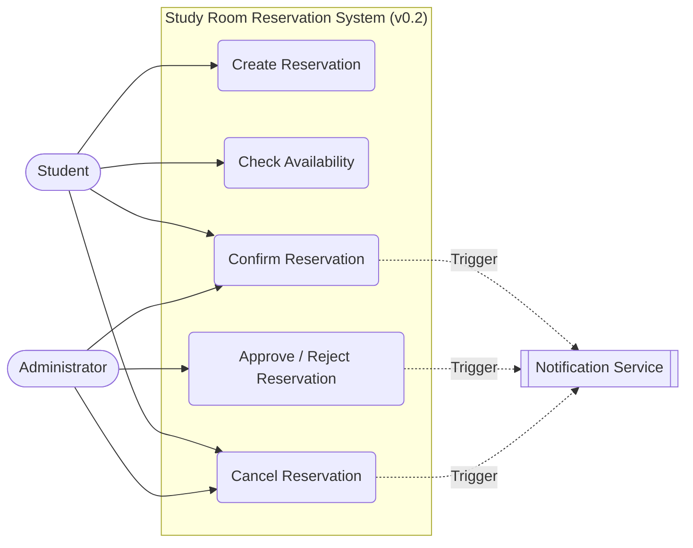
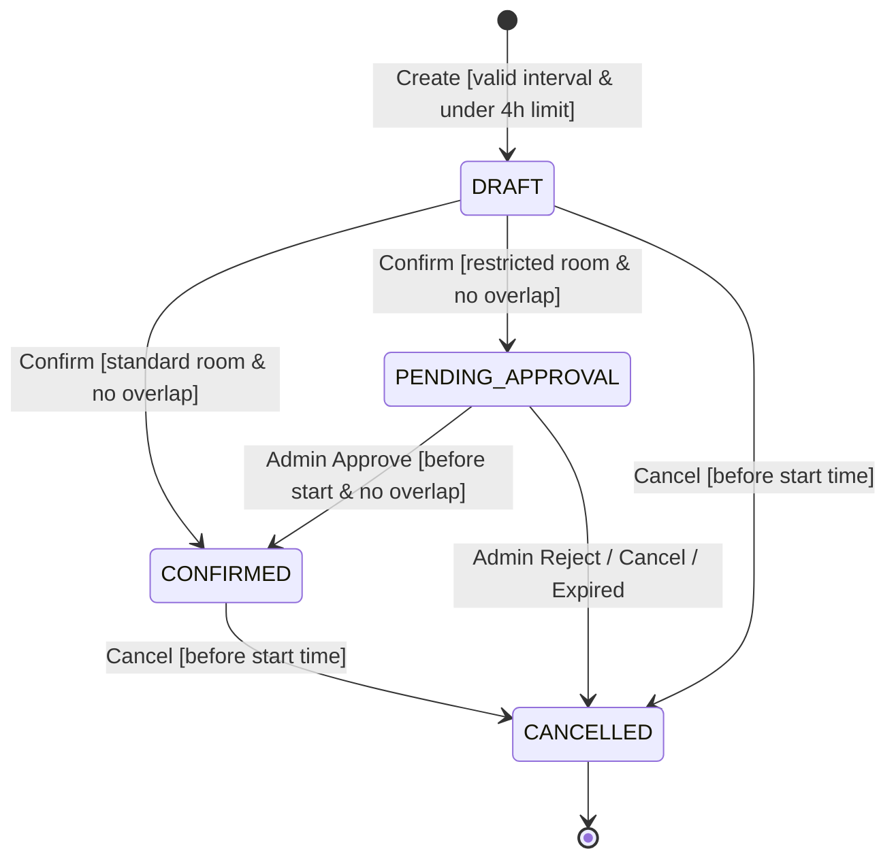

# Project Frame

## Reservation domain

We reserve Study Rooms.

## Purpose

The system provides university students with an equitable platform to reserve local campus study spaces for individual or group work. It exists to eliminate booking conflicts, maximize room utilization, and streamline room management for administrative staff.

## Users / Stakeholders

- **Student**: Creates initial reservation drafts and manages their allocated daily slots.
- **Administrator**: Approves, rejects, and manages the operational status of study rooms.

## Core concepts

- **Resource**: The physical Study Room containing attributes like name, capacity, and location.
- **Reservation**: The booking record tracking the allocated time block, state, and room reference.
- **User**: The identity of the student or administrator executing system commands.

## Core operations

- Create reservation
- Confirm / approve reservation
- Cancel reservation
- Check availability

## Persistent state

- **Resource Data:** ID, room name, capacity limits, and operational availability status flags.
- **Reservation Data:** ID, resource relationship ID, creator user ID, date, start time, end time, and state tracker string.

## State-changing operation

`DRAFT` → `CONFIRMED` (Upon authorization, verification, or administrator approval steps).
`CONFIRMED` → `CANCELLED` (When a user or admin revokes an active slot.

## Common business rule

Two CONFIRMED reservations for the exact same room must not overlap.

## Domain-specific business rule

A single user can book a maximum of 4 total hours per day, which can be divided across multiple custom time slots.

## External / system boundary

Notification Service.

## Assumption

We assume that the Notification Service will always respond within 2 seconds, allowing us to send emails synchronously during the booking process without freezing the API.

## Unknown

We do not yet know how the system should handle orphaned DRAFT reservations if a user abandons the application before hitting "Confirm".

## Selected future pressure

- **Category:** C (Changeability)
- **Concrete pressure:** Expanding the system to support additional bookable resources (e.g., projectors, whiteboards, or laptops) alongside rooms, each with entirely different maximum booking time limits.
- **Why it is relevant to our reservation system:** Study rooms often require physical equipment. If the university administration wants to manage hardware checkout through the same system, our data model and the hardcoded 4-hour daily limit rule will need to be refactored to handle dynamic rules based on the resource type.

---

# Stack Rationale

The team has opted for a Python-based stack because all members possess strong existing proficiency in the language, minimizing the learning curve and maximizing productivity for a time-boxed engineering exercise. FastAPI was selected for its fast execution, native support for asynchronous endpoints, and automatic API documentation. SQLite replaces PostgreSQL because its embedded, zero-configuration nature drastically simplifies local setup, making it trivial to achieve a reproducible build across different environments without managing external database containers.

---

# Baseline v0.1 — Minimum Behavior Specification

## Shared Business Rules

- **BR-01 Interval semantics:** Time slots are evaluated as `[start, end)`. A reservation ending at 10:00 does not conflict with one starting at 10:00.
- **BR-02 Exclusive Resource invariant:** At no committed state may two `CONFIRMED` Reservations overlap for the same exclusive Study Room.
- **BR-03 Cancellation policy:** A `DRAFT` or `CONFIRMED` Reservation can be cancelled by the User or Administrator at any time strictly before the start time.
- **BR-04 Domain-specific limit:** A single user can book a maximum of 4 total hours per day across all active `CONFIRMED` and `DRAFT` states.

## OP-01 — Create Reservation

**Goal / user value:** Secure an initial time slot for a study room.
**Trigger:** Student submits a request for a specific room and time interval.
**Observable requirement(s):** System records the intent but does not globally block the room for others.
**Preconditions:** Authorized Student; Resource exists; start time < end time.
**Success postcondition:** One `DRAFT` Reservation exists; no Resource allocation is committed yet.
**State change:** `[initial]` → `DRAFT`
**Referenced business rule(s) / invariant(s):** BR-01, BR-04.

**Main success scenario:**

1. Student submits Room ID, Date, Start Time, and End Time.
2. System validates authorization, room existence, and interval (BR-01).
3. System validates the user has not exceeded their 4-hour daily limit (BR-04).
4. System creates a `DRAFT` Reservation.
5. System returns the Reservation ID and state.

**Alternative / failure outcomes:**

- Exceeds 4-hour daily limit → reject, no creation.
- Invalid interval (start > end) or unknown Room → reject, no creation.

**Verification examples:**

- Valid interval + under limit → returns `DRAFT`.
- Booking a 5th hour in a day → rejected.

## OP-02 — Check Availability

**Goal / user value:** Discover open time slots for study rooms.
**Trigger:** User queries a room's availability for a specific interval.
**Observable requirement(s):** System reports whether the room is free or blocked.
**Preconditions:** Resource exists; valid interval.
**Success postcondition:** Accurate availability status returned; no state changed.
**State change:** None.
**Referenced business rule(s) / invariant(s):** BR-01, BR-02.

**Main success scenario:**

1. User requests availability for a specific Room ID and time interval.
2. System checks for any overlapping `CONFIRMED` reservations.
3. System returns `AVAILABLE` or `UNAVAILABLE`.

**Alternative / failure outcomes:**

- Unknown Room ID → returns error/404.

**Verification examples:**

- Interval overlaps an existing `CONFIRMED` reservation → `UNAVAILABLE`.
- Interval overlaps only a `DRAFT` reservation → `AVAILABLE`.

## OP-03 — Confirm Reservation

**Goal / user value:** Finalize the booking and block the room from other users.
**Trigger:** User (or Administrator) confirms a pending request.
**Observable requirement(s):** The reservation becomes active and blocks future availability checks for that time.
**Preconditions:** Reservation exists in `DRAFT` state; Resource is active.
**Success postcondition:** Reservation.state = `CONFIRMED`; exclusive-resource invariant remains true.
**State change:** `DRAFT` → `CONFIRMED`
**Referenced business rule(s) / invariant(s):** BR-02, BR-04.

**Main success scenario:**

1. User attempts to confirm a specific `DRAFT` Reservation ID.
2. System checks for overlapping `CONFIRMED` reservations (BR-02).
3. System updates state to `CONFIRMED`.
4. Reservation now blocks the Resource.

**Alternative / failure outcomes:**

- Concurrent conflict/Overlap detected → reject, remains `DRAFT` or fails with 409 Conflict.
- Invalid source state (already CANCELLED) → reject.

**Verification examples:**

- No overlap exists → state becomes `CONFIRMED`.
- Overlap exists with another confirmed slot → remains `DRAFT` (Confirmation rejected).
- Concurrent confirmation attempts on the same slot → exactly one reaches `CONFIRMED`.

## OP-04 — Cancel Reservation

**Goal / user value:** Release a booked or pending room so it can be used by others.
**Trigger:** User or Administrator requests cancellation.
**Observable requirement(s):** The reservation no longer blocks availability.
**Preconditions:** Reservation is in `DRAFT` or `CONFIRMED` state.
**Success postcondition:** Reservation.state = `CANCELLED`.
**State change:** `DRAFT` → `CANCELLED` or `CONFIRMED` → `CANCELLED`
**Referenced business rule(s) / invariant(s):** BR-03.

**Main success scenario:**

1. User submits a cancel request for a Reservation ID.
2. System verifies the current time is strictly before the reservation start time (BR-03).
3. System updates state to `CANCELLED`.

**Alternative / failure outcomes:**

- Current time is already past the start time → reject cancellation.
- Repeated cancellation attempt → idempotent (returns success but makes no new changes).

**Verification examples:**

- Cancellation requested 1 hour before start → state becomes `CANCELLED`.
- Cancellation requested 5 minutes after start → rejected.

---

# Baseline v0.2 — Change: Approval Workflow

## 1. Change Impact Analysis

- **Changed condition:** Certain high-capacity or specialized Study Rooms (e.g., resources prefixed with `VIP_` or flagged as `requires_approval`) require explicit authorization by an Administrator before a reservation can reach the `CONFIRMED` state. Approval may be delayed, rejected, or expire if not handled before the reservation start time.
- **Affected requirements / slices:**
  - `OP-03 (Confirm Reservation)`: When a Student attempts to confirm a `DRAFT` for an approval-required room, the system cannot immediately transition it to `CONFIRMED`. Instead, it transitions the reservation to `PENDING_APPROVAL`.
  - `OP-04 (Cancel Reservation)` & `BR-03`: Expanded to allow Students and Administrators to cancel reservations currently waiting in the `PENDING_APPROVAL` state.
  - `BR-04 (4-hour daily limit)`: Calculations for a user's active daily hours must now include `PENDING_APPROVAL` reservations alongside `DRAFT` and `CONFIRMED` so users cannot bypass the 4-hour limit by queuing up multiple unapproved requests.
- **Unaffected requirements / slices + reason:**
  - `OP-01 (Create Reservation)`: Remains unaffected. Creating an initial reservation still yields an uncommitted `DRAFT` state regardless of room type.
  - `OP-02 (Check Availability)`: Remains unaffected. Only `CONFIRMED` reservations block a room's availability; `DRAFT` and `PENDING_APPROVAL` states do not globally block the slot until finalized.
  - `BR-01 (Interval semantics)` & `BR-02 (Exclusive Resource invariant)`: Remain unaffected. Time evaluations `[start, end)` and the strict prohibition on overlapping `CONFIRMED` reservations hold universally.
- **New actor / operation:**
  - Actor: `Administrator` (gains formal approval/rejection execution duties).
  - Operation: `OP-05 — Approve / Reject Reservation`.
- **Changed rules / state semantics:**
  - Added state `PENDING_APPROVAL` to the reservation lifecycle.
  - An expired approval (where current time reaches `start_time` while still in `PENDING_APPROVAL`) is rejected and transitions to `CANCELLED`.
- **New verification examples:**
  - Confirming a standard room (`Room1`) transitions directly: `DRAFT` → `CONFIRMED`.
  - Confirming a restricted room (`VIP_Room1`) transitions: `DRAFT` → `PENDING_APPROVAL`.
  - Administrator approving a `PENDING_APPROVAL` reservation with no overlaps transitions: `PENDING_APPROVAL` → `CONFIRMED`.
  - Administrator rejecting a `PENDING_APPROVAL` reservation transitions: `PENDING_APPROVAL` → `CANCELLED`.
- **Architecture driver(s) for C03:**
  - **State Machine & Guard Complexity:** Mixing HTTP routing, SQLite queries, and complex branching state transitions (`DRAFT` → `PENDING_APPROVAL` vs `CONFIRMED`) inside a single monolithic file (`src/main.py`) is becoming brittle and hard to maintain. C03 will require separating domain logic and state rules from the FastAPI transport layer.
  - **Concurrency & Locking:** Delayed approvals increase the window for race conditions where two requests wait in `PENDING_APPROVAL` for the same slot, requiring isolated transactional boundaries when an Administrator triggers approval.

---

## 2. New Operation Slice: OP-05 — Approve / Reject Reservation

**Goal / user value:** Allow an Administrator to review, approve, or reject pending reservation requests for restricted study rooms to prevent misuse of specialized campus spaces.
**Trigger:** Administrator submits an approval or rejection decision for a reservation in the `PENDING_APPROVAL` state.
**Observable requirement(s):** If approved, the reservation becomes `CONFIRMED`, blocks the resource, and triggers the Notification Service. If rejected (or expired), it transitions to `CANCELLED` and frees the user's daily hour quota.
**Preconditions:** Actor is an Administrator; Reservation exists and is currently in `PENDING_APPROVAL` state; current time is strictly before `start_time`.
**Success postcondition:** Reservation state is updated to `CONFIRMED` (on approval) or `CANCELLED` (on rejection); exclusive-resource invariant holds.
**State change:** `PENDING_APPROVAL` → `CONFIRMED` or `PENDING_APPROVAL` → `CANCELLED`.
**Referenced business rule(s) / invariant(s):** BR-01, BR-02.

**Main success scenario (Approval):**

1. Administrator submits an `approve` decision for a specific Reservation ID.
2. System verifies the reservation is in the `PENDING_APPROVAL` state and has not expired (`now < start_time`).
3. System checks for any overlapping `CONFIRMED` reservations on the same resource (BR-02).
4. System updates the reservation state to `CONFIRMED`.
5. System triggers the Notification Service to inform the Student.

**Alternative / failure outcomes:**

- Administrator submits a `reject` decision → System updates state to `CANCELLED` and notifies the Student.
- Overlapping `CONFIRMED` reservation already exists on approval attempt → Reject approval with 409 Conflict; reservation remains `PENDING_APPROVAL` (or Administrator cancels it).
- Approval attempted after `start_time` (Expired) → Reject approval with 400 Bad Request and transition state to `CANCELLED`.
- Reservation is not in `PENDING_APPROVAL` state → Reject with 400 Bad Request.

**Verification examples:**

- Approve valid `PENDING_APPROVAL` slot with no overlap → state becomes `CONFIRMED`.
- Reject `PENDING_APPROVAL` slot → state becomes `CANCELLED`.
- Approve `PENDING_APPROVAL` slot when another reservation was already confirmed for that time → rejected with 409 Conflict.

---

## 3. Updated Visual Models (Baseline v0.2)

### 1. Updated Use-Case / Actor-Goal View (v0.2)

### 2. Updated Reservation Lifecycle Statechart (v0.2)

